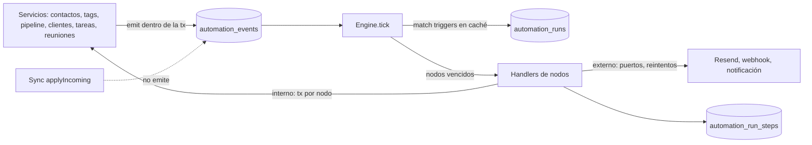

# Diseño · Automatizaciones

## Decisiones

| #   | Decisión                                                                                                               | Por qué                                                                                                                                                                                                                   |
| --- | ---------------------------------------------------------------------------------------------------------------------- | ------------------------------------------------------------------------------------------------------------------------------------------------------------------------------------------------------------------------- |
| D1  | Árbol de nodos con `next` por puerto. Las aristas se derivan y no se guardan.                                          | GHL hace lo mismo [GHL 4.1]. Valida y dibuja fácil, y no tiene uniones ambiguas.                                                                                                                                          |
| D2  | Autolayout vertical propio sobre `@xyflow/react`, sin coordenadas guardadas.                                           | Sin estado de posición que sincronizar ni que se desordene [GHL 1.1]. La dependencia ya está.                                                                                                                             |
| D3  | Cada ejecución queda fijada a una versión publicada e inmutable.                                                       | GHL lee la definición viva y eso causa contactos retirados y esperas que no cambian [GHL 6.4]. Fijar la versión es predecible y testeable.                                                                                |
| D4  | Outbox transaccional local `automation_events` escrito por los servicios.                                              | El evento se escribe en la misma transacción que el cambio, así que no se pierde si la app se cierra. La sincronización escribe con `applyIncoming`, sin pasar por los servicios, así que no dispara nada en otro equipo. |
| D5  | Definiciones y versiones se sincronizan. Eventos, ejecuciones y pasos son solo locales.                                | El equipo comparte la misma automatización, y cada Mac ejecuta lo que pasa en él. Los secretos no viajan: un email sin Resend en ese equipo se omite con el motivo.                                                       |
| D6  | Registro de nodos en dos mitades: la especificación en `shared` y el handler en `main`.                                | El editor, MCP y la validación leen la especificación; el motor lee el handler. Así se cumple R13.                                                                                                                        |
| D7  | Un solo motor por proceso, que nunca hace dos ticks a la vez, con un tick de 15 s y un kick tras el commit.            | Mismo patrón que `MarketingSync`. Serializa los pasos de dominio y evita las carreras [GHL 6.5].                                                                                                                          |
| D8  | Caché en memoria de las versiones vigentes de las automatizaciones activas, recargada cuando cambia `max(updated_at)`. | Hay decenas de automatizaciones, no millones, y no hace falta un índice de triggers como el de GHL [GHL 2.2].                                                                                                             |

## Vista general



Hexagonal dentro del módulo:

- **Dominio puro** en `src/shared/automations/`.
- **Aplicación** en `src/main/automations/`: motor, servicio y outbox.
- **Adaptadores:** los handlers, que usan los servicios existentes a través de puertos; los
  repositorios TypeORM; y HTTP, IPC y MCP.

## Dominio · `src/shared/automations/`

```
model.ts       tipos de definición, ejecución y paso
catalog.ts     TRIGGERS y NODES: especificaciones con ParamSpec
conditions.ts  operadores por tipo, evaluate(groups, scope)
template.ts    render(texto, scope), con escape HTML opcional
graph.ts       insert, remove, removeBranch, move, canMove, slots, clone, pathTo, upstream, layout
validate.ts    validateDefinition(def, refs): Issue[]
describe.ts    frases para la lista y los nodos cerrados
```

### Modelo

```ts
export type SubjectType = 'contact' | 'prospect' | 'client' | 'task' | 'meeting' | 'none'
export type AutomationStatus = 'draft' | 'active' | 'paused' | 'locked'

export interface Condition {
  field: string
  operator: Operator
  value?: string | number | string[]
}
export interface ConditionGroup {
  join: 'and' | 'or'
  conditions: Condition[]
}

export interface TriggerDef {
  id: string
  type: TriggerType
  params: Record<string, unknown>
  conditions: ConditionGroup[]
}

export interface NodeDef {
  id: string
  type: NodeType
  name: string
  params: Record<string, unknown>
  next: Record<string, string | null>
}

export interface Definition {
  subject: SubjectType
  settings: { reentry: 'allow' | 'never'; window: TimeWindow | null }
  triggers: TriggerDef[]
  root: string | null
  nodes: Record<string, NodeDef>
}

export interface Automation {
  id: string
  name: string
  status: AutomationStatus
  draft: Definition
  versionId: string | null
  versionNumber: number | null
  destructive: boolean
  createdAt: string
  updatedAt: string
}
```

Los puertos dependen del tipo de nodo:

- una acción tiene `{ next }`;
- If/Else tiene `{ [branchId]: …, none }` y sus ramas en `params.branches`;
- una espera por condición tiene `{ met, timeout }`;
- «Ir a» guarda el destino en `params.target`, y finalizar tiene `{}`.

### Catálogo

```ts
export interface ParamSpec {
  key: string
  label: string
  kind:
    | 'text'
    | 'markdown'
    | 'number'
    | 'select'
    | 'tag'
    | 'pipeline'
    | 'stage'
    | 'client'
    | 'project'
    | 'field'
    | 'url'
    | 'duration'
    | 'datetime'
    | 'conditions'
    | 'branches'
    | 'node'
  required?: boolean
  vars?: boolean
  options?: { value: string; label: string }[]
}

export interface NodeSpec {
  type: NodeType
  kind: 'action' | 'control'
  group:
    'contacto' | 'pipeline' | 'clientes' | 'email' | 'productividad' | 'integraciones' | 'control'
  label: string
  description: string
  icon: string
  subjects: SubjectType[] | 'any'
  external: boolean
  destructive: boolean
  communication: boolean
  params: ParamSpec[]
  ports(params): string[]
  outputs?: { key: string; label: string }[]
  validate?(params, refs): Issue[]
  sentence(params, refs): string
}
```

`TRIGGERS` sigue la misma forma, con `subject`, `params` y `matches(params, event)`.

### Funciones puras, con tests

- `evaluate(groups, scope)`:
  - un grupo `and` se cumple si se cumplen todas sus condiciones; uno `or`, si se cumple alguna;
  - entre grupos rige AND;
  - un campo que falta cuenta como vacío.
- `pickBranch(branches, scope)` devuelve la primera rama que se cumple, o `none`.
- `render(text, scope)` resuelve el sujeto, `trigger.*` y `steps.<id>.*`; lo desconocido queda
  vacío.
- `graph.layout(def)` devuelve coordenadas por nodo:
  - columna centrada;
  - las ramas se reparten por ancho de subárbol;
  - las tarjetas tienen ancho fijo.
- `graph.slots(def)` lista los huecos: `{ parent: nodeId | 'root', port }`, uno por puerto.
- `graph.move(def, nodeId, slot, mode)` con `mode` `node` o `subtree`. En `node`, el hijo del
  puerto `next` del nodo se reconecta a su padre y el nodo entra solo en el hueco; un If/Else
  siempre se mueve con sus ramas. El nodo que estaba en el hueco pasa a colgar del puerto principal
  del nodo movido, o del final del subárbol.
- `graph.canMove(def, nodeId, slot, mode)` devuelve el motivo si es inválido: dentro de sí mismo,
  «Ir a» deja de ser hoja, destino de «Ir a» queda debajo, sujeto incompatible.
- `graph.clone(def, nodeId, mode)` copia con ids nuevos y remapea los destinos de «Ir a» internos.
- `graph.upstream(def, nodeId)` da los nodos anteriores del camino; lo usan el selector de
  variables y «Ir a».
- `validateDefinition(def, refs)` comprueba:
  - árbol válido;
  - que cada «Ir a» sea hoja y apunte hacia arriba;
  - parámetros requeridos;
  - nodos compatibles con el sujeto;
  - referencias existentes: tag, etapa, cliente y proyecto;
  - triggers del mismo sujeto;
  - al menos un trigger y una raíz.

## Datos

Migración `AddAutomations1729600000000`.

```sql
CREATE TABLE automations (id TEXT PRIMARY KEY, name TEXT NOT NULL, status TEXT NOT NULL DEFAULT 'draft',
  draft TEXT NOT NULL, version_id TEXT NULL, destructive BOOLEAN NOT NULL DEFAULT 0,
  created_at TEXT NOT NULL, updated_at TEXT NOT NULL, updated_by TEXT NULL, deleted_at TEXT NULL);

CREATE TABLE automation_versions (id TEXT PRIMARY KEY, automation_id TEXT NOT NULL,
  number INTEGER NOT NULL, definition TEXT NOT NULL, published_at TEXT NOT NULL,
  published_by TEXT NULL, created_at TEXT NOT NULL, updated_at TEXT NOT NULL,
  UNIQUE (automation_id, number));

CREATE TABLE automation_events (id TEXT PRIMARY KEY, type TEXT NOT NULL, subject_type TEXT NOT NULL,
  subject_id TEXT NULL, payload TEXT NOT NULL, cause TEXT NULL, created_at TEXT NOT NULL,
  processed_at TEXT NULL);
CREATE INDEX idx_aevents_pending ON automation_events (processed_at, created_at);

CREATE TABLE automation_runs (id TEXT PRIMARY KEY, automation_id TEXT NOT NULL, version_id TEXT NOT NULL,
  subject_type TEXT NOT NULL, subject_id TEXT NULL, trigger_id TEXT NULL, event TEXT NOT NULL,
  status TEXT NOT NULL, node_id TEXT NULL, next_at TEXT NULL, wait TEXT NULL,
  attempts INTEGER NOT NULL DEFAULT 0, outputs TEXT NOT NULL DEFAULT '{}', depth INTEGER NOT NULL DEFAULT 0,
  cause_run_id TEXT NULL, late BOOLEAN NOT NULL DEFAULT 0, reason TEXT NULL, origin TEXT NOT NULL,
  created_at TEXT NOT NULL, updated_at TEXT NOT NULL, finished_at TEXT NULL);
CREATE INDEX idx_aruns_due ON automation_runs (status, next_at);
CREATE INDEX idx_aruns_auto ON automation_runs (automation_id, created_at);
CREATE INDEX idx_aruns_subject ON automation_runs (subject_type, subject_id, automation_id);
CREATE UNIQUE INDEX idx_aruns_open ON automation_runs (automation_id, subject_id)
  WHERE status IN ('active', 'waiting') AND subject_id IS NOT NULL;

CREATE TABLE automation_run_steps (id TEXT PRIMARY KEY, run_id TEXT NOT NULL, automation_id TEXT NOT NULL,
  node_id TEXT NOT NULL, node_type TEXT NOT NULL, status TEXT NOT NULL, attempt INTEGER NOT NULL DEFAULT 1,
  message TEXT NULL, output TEXT NULL, started_at TEXT NOT NULL, ended_at TEXT NULL);
CREATE INDEX idx_asteps_run ON automation_run_steps (run_id, started_at);
CREATE INDEX idx_asteps_node ON automation_run_steps (automation_id, node_id, status);

CREATE TABLE automation_trigger_log (id TEXT PRIMARY KEY, automation_id TEXT NOT NULL, trigger_id TEXT NOT NULL,
  event_id TEXT NOT NULL, subject_id TEXT NULL, outcome TEXT NOT NULL, reason TEXT NULL, created_at TEXT NOT NULL);
```

### Estados

- **Ejecución:** `active`, que está corriendo un nodo; `waiting`; `finished`; `failed`;
  `cancelled`.
- **Paso:** `ok`, `skipped`, `waiting`, `failed` y `retrying`.
- **Log de trigger:** `enrolled`, `filtered`, `already_enrolled`, `paused` y `loop_limit`.

### Sincronización y edición

- `SYNC_TABLES`: sale `rules` y entran `automations` y `automation_versions`.
- `SOFT_DELETE_TABLES` incluye `automations`.
- `NEVER_SYNC.tables` incluye `automation_events`, `automation_runs`, `automation_run_steps` y
  `automation_trigger_log`.
- El servidor N3 acepta las tablas nuevas, y `describeChange` de N5 registra `automations` con los
  verbos `created`, `renamed` y `updated`. Publicar cuenta como `updated` con el detalle «publicó
  v3».

### Retención

Una vez al día, el motor borra los pasos, las ejecuciones cerradas y el log de triggers con más de
60 días, y los eventos procesados con más de 7.

## Aplicación · `src/main/automations/`

```
events.ts      emit(manager, event), con causa tomada del contexto, y tipos de evento
engine.ts      AutomationEngine { start, stop, kick, tick }
enroll.ts      eventos → triggers → ejecuciones, con el log de triggers
runner.ts      avanzar una ejecución nodo a nodo
cache.ts       versiones vigentes de las automatizaciones activas
service.ts     AutomationService: CRUD, publicar, versiones, estado, ejecuciones, probar, manual
handlers/      un archivo por grupo, más index.ts que arma HANDLERS
ports.ts       EmailPort, HttpPort, NotifierPort, Clock
store.ts       repositorios TypeORM de las tablas
```

### Emisión de eventos

`emit(manager, { type, subject: { type, id }, payload })` inserta en `automation_events` dentro de
la transacción del servicio y llama a `afterCommit(manager, () => engine.kick())`. Se emite desde:

- `contact.service`: creado, actualizado con los campos cambiados, `changeTags` por tag añadido o
  quitado, y `setStatus`;
- `prospect.service`: creado, cambio de etapa, ganado y perdido;
- `client.service`: creado;
- `task.service`: completada;
- el pipeline de reuniones cuando una reunión queda lista;
- `hub-sync.applyLead`, que crea el contacto y añade tags a través de los mismos ayudantes.

La causa viaja en un `AsyncLocalStorage`, `withCause({ runId, automationId, depth })`, que activa
el runner al ejecutar un handler. Así un evento emitido por una acción hereda la cadena.

### Ciclo del motor

```
tick():
  si ya hay un tick, marca again y sale
  cache.refreshIfChanged()
  drenar hasta 200 eventos pendientes, en orden
    para cada automatización activa con un trigger que coincide:
      enroll(event, automation, trigger)
    marcar el evento como procesado
    despertar las ejecuciones que esperan un evento de ese sujeto
  correr hasta 50 ejecuciones vencidas, ordenadas por next_at
  purga diaria
```

`enroll`, en este orden de rechazo, cada uno con su línea en el log de triggers:

1. `paused`: la automatización no está activa.
2. Las condiciones del trigger no se cumplen: `filtered`.
3. `loop_limit`: `cause.depth >= 5`, o `cause.automationId` es esta misma automatización.
4. Más de 20 entradas del sujeto en 30 minutos: la automatización pasa a `locked`, se registra
   `loop_limit` y sale un aviso.
5. `already_enrolled`: hay una ejecución abierta, por el índice único, o `reentry = never` y ya hay
   una en la historia.

Si pasa todo, inserta la ejecución con `status = active`, `node_id = root` y `next_at = now`.

### Runner

El runner avanza la ejecución hasta que tiene que esperar o termina, con un tope de 100 nodos por
pasada para cortar bucles de «Ir a»:

```ts
type NodeResult =
  | { kind: 'next'; port?: string; output?: Record<string, unknown> }
  | { kind: 'wait'; until: string | null; event?: WaitEvent; timeoutAt?: string }
  | { kind: 'skip'; reason: string; port?: string }
  | { kind: 'fail'; reason: string; retryable: boolean }

interface NodeHandler {
  run(ctx: NodeContext): Promise<NodeResult>
}

interface NodeContext {
  manager?: EntityManager
  run: RunView
  node: NodeDef
  scope: Scope
  render(text: string, opts?: { html?: boolean }): string
  ports: Ports
  idempotencyKey: string
  dryRun: boolean
}
```

- **Nodo interno:** `transactionGuard` más `withCause`, `handler.run(ctx)` y, en la misma
  transacción, el paso, la salida y el puntero al siguiente nodo.
- **Nodo externo:** sin transacción.
  - Si `fail` es reintentable y quedan intentos: `attempts++`, `next_at = now + [1, 5, 30]
min`, `status = waiting` y el paso queda `retrying`.
  - Si no: `failed` con «límite de reintentos».
- **Ventana horaria:** si el nodo es `communication` y estamos fuera de la ventana, la ejecución
  espera hasta la siguiente apertura y no corre el handler.
- **Esperas:**
  - `wait` con `until` deja `next_at = until`.
  - `wait` con `event` guarda `wait = { event, timeoutAt }` y `next_at = timeoutAt`.
  - Al despertar por evento, la ejecución vuelve a evaluar la condición: si se cumple sale por
    `met`; si vence, sale por `timeout`.
- **Puerto nulo**, o nodo `finish`: `finished`.
- **Recuperación al arrancar:** `active` pasa a vencida ahora. Las ejecuciones vencidas hace más
  de 5 minutos quedan con `late = 1`.
- **Pausa:** el runner no toma ejecuciones de automatizaciones `paused` ni `locked`.
- **Aviso de fallo:** cuando una ejecución queda `failed`, o la automatización se bloquea por
  bucle, `NotifierPort.notify` avisa como máximo una vez por automatización cada 24 h. La marca vive
  en memoria del motor; un reinicio puede repetir un aviso, lo cual es aceptable.

### Handlers de control

- `if_else` usa `pickBranch` sobre el `scope` recargado.
- `wait` calcula `until` desde la duración, desde una fecha fija o desde un campo del sujeto más
  un desplazamiento. En una espera por condición, si ya se cumple sale por `met` sin esperar.
- `go_to` devuelve `next` hacia `params.target`. El runner valida que el destino esté en
  `upstream`.
- `finish` devuelve `next` con el puerto nulo.

### Handlers de dominio

Usan los ayudantes que ya reciben `manager`:

- `changeTags` con `rules: false`; el flag se elimina.
- `setStatus`.
- `convert`.
- `insertProspect`.
- `moveProspect`, que se extrae de `ProspectService.move`.
- `insertClient`.
- `insertTaskWithRoom`.
- `insertNote`.
- `removeProspect`.
- `removeContact`.

Los externos usan los puertos:

- `EmailPort.send({ to, subject, html, idempotencyKey })` sobre el gateway de Resend. El gateway
  actual no acepta la clave; el paso solo se repite cuando el envío falló, así que no duplica.
- Markdown a HTML con `markdownToHtml` propio y pequeño, sin dependencia nueva: párrafos, saltos,
  negritas, cursivas, enlaces, listas y títulos. Los valores de las variables se escapan.
- `HttpPort.request({ url, method, json, timeoutMs: 10000 })`, solo `https://`. Devuelve `status` y
  `body` truncado a 10 KB como salida.
- `NotifierPort.notify`.

Si un puerto no está configurado en este equipo, el nodo devuelve `skip` con «Resend no
configurado en este equipo».

### Servicio

`AutomationService`:

- `list`: frases, estado, versión y conteos de ejecuciones por estado y por errores de 24 h.
- `get`.
- `create(subject)`.
- `saveDraft(id, def)`: valida tipos y guarda aunque tenga errores, y devuelve los `issues`.
- `publish(id, { acknowledgeDestructive })`.
- `versions`.
- `restore(id, versionId)`.
- `setStatus(id, status)`.
- `remove`.
- `runs(filter)`.
- `run(id)`, con sus pasos.
- `steps(filter)`.
- `triggerLog(filter)`.
- `stats(id)`: conteos por `node_id` y estado.
- `cancel(runId)`.
- `resume(runId)`.
- `retry(runId)`.
- `retryNode(automationId, nodeId)`.
- `test(def | id, subjectId)`: dry run. Recorre el árbol con `dryRun: true` sin `manager` de
  escritura; los handlers devuelven lo que harían, y las esperas se dan por cumplidas.
- `runManual(id, subjectId, origin)`.
- `references(kind, id)`: lo usan Tags y Pipelines para avisar antes de borrar algo que una
  automatización usa.

Cada acción manual escribe el origen: en `origin` de la ejecución, o en el `message` del paso.

## API, IPC y MCP

- Rutas Express `/automations`: CRUD, `/publish`, `/versions`, `/status`, `/runs`, `/runs/:id`,
  `/runs/:id/cancel`, `/runs/:id/resume`, `/runs/:id/retry`, `/stats`, `/trigger-log` y `/test`.
- IPC `automations:*` y preload `window.api.automations`, con el mismo patrón que `ipc.marketing`.
- `onChanged` emite al renderer cuando cambia una ejecución, para refrescar en vivo.
- MCP en `src/mcp/tools/automations.ts` con las herramientas de R12. `list_automation_catalog`
  serializa `TRIGGERS` y `NODES` sin funciones.

## UI · `src/renderer/src/consultora/`

```
screens/Automations.tsx            lista: frase, estado, versión, conteos, insignia de errores; ejemplos de un clic
screens/AutomationEditor.tsx       pestañas Lienzo, Ajustes, Inscripciones, Registro; barra de publicar
organisms/automation/Canvas.tsx    ReactFlow controlado con graph.layout, minimapa, zoom, modo stats, arrastre a huecos
hooks/useTreeDrag.ts               arrastre: nodo o subárbol con Alt, huecos válidos con canMove, soltar con move
organisms/automation/NodePicker.tsx  panel lateral: buscador, grupos, favoritos, atenuados con motivo
organisms/automation/NodePanel.tsx   panel lateral: nombre, campos por ParamSpec, guardar, cancelar, borrar
organisms/automation/BranchesEditor.tsx  ramas reordenables, grupos AND u OR, rama None fija
organisms/automation/RunsTable.tsx   inscripciones con filtros y acciones
organisms/automation/StepsTable.tsx  registro por paso
organisms/automation/TestDrawer.tsx  simulación paso a paso
molecules/automation/NodeCard.tsx    icono, nombre, frase, badge de error, conteos en modo stats
molecules/automation/TriggerCard.tsx
molecules/automation/AddButton.tsx   el + entre nodos
molecules/automation/ParamField.tsx  un campo por kind
molecules/automation/ConditionRow.tsx
molecules/automation/VariableMenu.tsx  variables del sujeto, del trigger y de steps upstream
hooks/useAutomationDraft.ts         borrador local, autoguardado con debounce de 800 ms, deshacer y rehacer
```

- `sections.ts`: `rules` se reemplaza por `automations`, «Automatizaciones», con el icono
  `Workflow`. Desaparece `screens/Rules.tsx`.
- Ficha de contacto, prospecto y cliente: una sección «Automatizaciones» con las ejecuciones del
  sujeto, y «Ejecutar automatización» en «Más».
- Brief para impeccable, con registro Operate:
  - el lienzo se lee de arriba abajo como se ejecuta;
  - las tarjetas son de ancho fijo y la línea vertical es hairline;
  - la espera es una pill sobre el hilo;
  - las ramas llevan su nombre en una etiqueta sobre la línea;
  - color con significado: destructivo en rose, error en coral, borrador al 60%;
  - un solo panel lateral abierto a la vez;
  - publicar en apricot, con el contador de errores al lado.

## Tests

- **Dominio:** `evaluate`, `pickBranch`, `render`, `layout`, `upstream`, `move`, `canMove`, `clone`
  y `validateDefinition`,
  con un caso por regla del validador.
- **Registro:** cada `NodeSpec` tiene su handler y viceversa, y cada `ParamSpec` requerido aparece
  en `validate`.
- **Motor:** con SQLite en memoria y un `Clock` falso:
  - inscripción y reentrada;
  - índice único de ejecución abierta;
  - espera por tiempo con recuperación tras reinicio;
  - espera por condición con `met` y con `timeout`;
  - reintentos 1, 5, 30 y luego `failed`;
  - bucle A y B cortado;
  - candado de 20 en 30 min;
  - pausa y reanudación;
  - versión fijada tras publicar otra;
  - dry run sin escrituras.
- **Sincronización:** un cambio aplicado con `applyIncoming` no crea filas en
  `automation_events`.
- **Migración:** reglas de ejemplo pasan a automatizaciones equivalentes.
