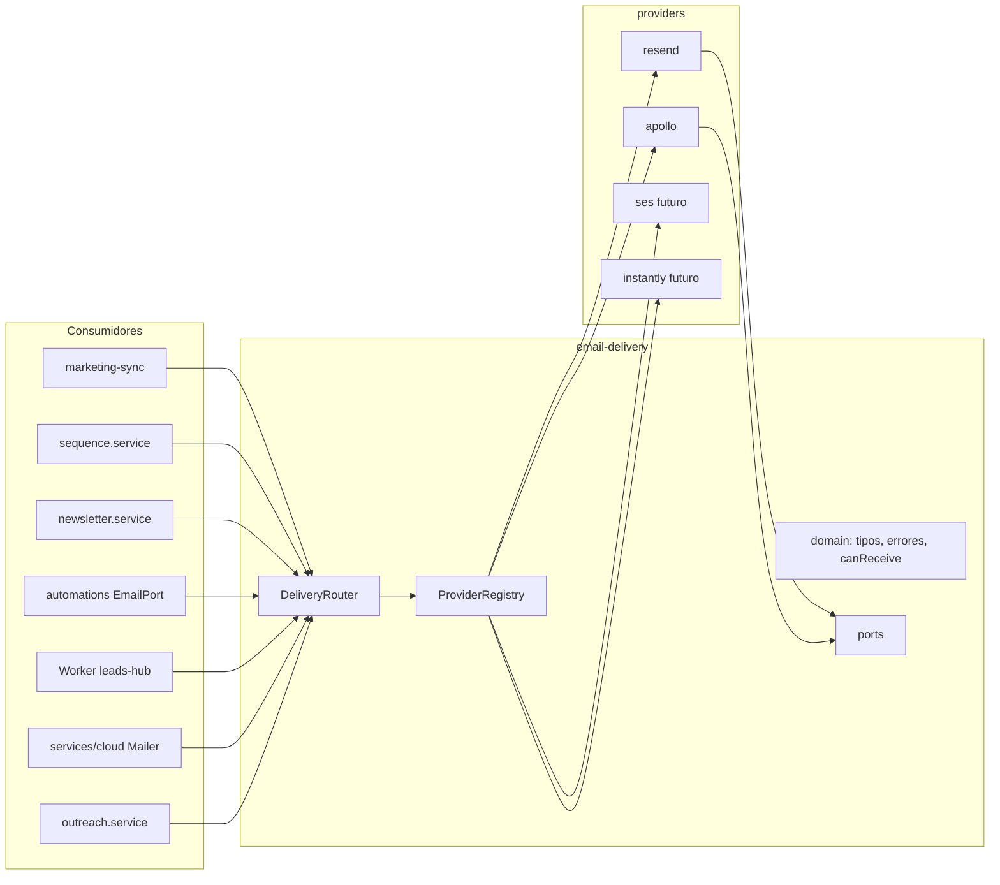
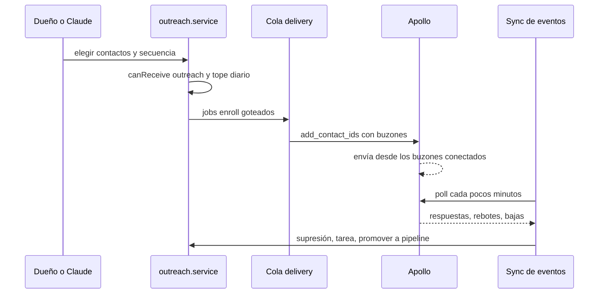

# Diseño · Capa de proveedores de email

## Vista general



Regla de dependencias: los consumidores dependen de `email-delivery`. `email-delivery` no depende
de nadie. Cada proveedor depende solo de `domain` y `ports` y de su propio SDK o API.

## Estructura de carpetas

```
src/shared/email-delivery/
  index.ts                 API pública. Único punto de import
  domain/
    capabilities.ts        Capability, DeliveryRole, ProviderPolicy, ProviderLimits
    errors.ts              DeliveryError y subclases, EmailProviderError
    recipient.ts           Recipient y canReceive
    names.ts               splitName
    events.ts              DeliveryEvent, DeliveryEventType
  ports/
    sender.ts              EmailSender
    audience.ts            AudienceStore
    sequences.ts           SequenceEngine
    broadcasts.ts          BroadcastSender
    events.ts              DeliveryEventSource
    provider.ts            EmailProvider, ProviderDescriptor
  application/
    registry.ts            ProviderRegistry
    router.ts              DeliveryRouter
  providers/
    resend/                index, client, sender, audience, sequences, broadcasts, events, errors
    apollo/                fase 3
  README.md                Cómo añadir un proveedor
```

Fakes y suite de contrato viven fuera, por convención del repo:

```
src/main/test/email-delivery/fake-provider.ts
src/main/test/email-delivery/contract.ts
src/test/email-delivery-*.test.ts
```

## Dominio

```ts
export type Capability = 'send' | 'audience' | 'sequences' | 'broadcasts' | 'events'
export type DeliveryRole = 'transactional' | 'marketing' | 'outreach'

export interface ProviderPolicy {
  coldOutreach: boolean
  sender: 'domain' | 'mailbox'
}

export interface ProviderLimits {
  minIntervalMs: number
  dailyCap: number | null
}
```

`canReceive` usa un tipo propio, sin importar `@shared/marketing`, para que la capa sea extraíble.
`Contact.status` encaja de forma estructural.

```ts
export interface Recipient {
  email: string | null
  status: 'none' | 'subscribed' | 'unsubscribed' | 'bounced' | 'complained'
}

export type Eligibility = { ok: true } | { ok: false; reason: string }

export function canReceive(role: DeliveryRole, r: Recipient): Eligibility
```

Tabla de verdad:

| Rol | Sin email | none | subscribed | unsubscribed, bounced, complained |
| --- | --- | --- | --- | --- |
| transactional | no | sí | sí | sí |
| marketing | no | no | sí | no |
| outreach | no | sí | sí | no |

Errores:

```ts
export class DeliveryError extends Error {}
export class CapabilityNotSupported extends DeliveryError {}
export class ProviderNotConfigured extends DeliveryError {}
export class RoleNotAssigned extends DeliveryError {}
export class RolePolicyViolation extends DeliveryError {}

export type ErrorKind = 'fatal' | 'retryable' | 'rejected'

export class EmailProviderError extends DeliveryError {
  constructor(
    message: string,
    readonly provider: string,
    readonly code: string,
    readonly status: number | null,
    readonly kind: ErrorKind
  )
  get fatal(): boolean
  get retryable(): boolean
}
```

Clasificación común: credencial inválida es `fatal`. Red, 429 y 5xx son `retryable`. El resto de
4xx es `rejected`. Hoy `automations/adapters.ts` calcula `retryable` mirando el status de
`ResendError`. Esa lógica pasa a `kind`.

## Puertos

```ts
export interface OutboundEmail {
  from?: string
  to: string
  replyTo?: string
  subject: string
  html: string
  text?: string
  idempotencyKey?: string
}

export interface SendReceipt {
  id: string
}

export interface EmailSender {
  send(mail: OutboundEmail): Promise<SendReceipt>
}
```

```ts
export interface RemoteContact { id: string; email: string; unsubscribed: boolean }
export interface RemoteGroup { id: string; name: string }

export interface ContactInput {
  email: string
  firstName?: string | null
  lastName?: string | null
  unsubscribed: boolean
  groupIds?: string[]
}

export interface AudienceStore {
  findContact(email: string): Promise<RemoteContact | null>
  createContact(input: ContactInput): Promise<string>
  updateContact(
    email: string,
    patch: { firstName?: string | null; lastName?: string | null; unsubscribed?: boolean }
  ): Promise<void>
  groupsOf(email: string): Promise<RemoteGroup[]>
  addToGroup(email: string, groupId: string): Promise<void>
  removeFromGroup(email: string, groupId: string): Promise<void>
  ensureGroup(name: string): Promise<string>
  deleteGroup(id: string): Promise<void>
}
```

Grupo es el nombre neutral. En Resend es un Segment. En Apollo es una etiqueta.

```ts
export type EntryMode = 'event' | 'enrollment'

export interface SequenceStep {
  wait: string
  subject: string
  html: string
}

export type SequenceEntry = { mode: 'event'; event: string } | { mode: 'enrollment' }

export interface SequenceDraft {
  id?: string
  name: string
  entry: SequenceEntry
  steps: SequenceStep[]
  enabled: boolean
}

export interface SequenceInfo {
  id: string
  name: string
  enabled: boolean
  event: string | null
  steps: number
  createdAt: string
  url: string
}

export interface EnrollRequest {
  emails: string[]
  mailboxIds?: string[]
  paused?: boolean
}

export interface SequenceEngine {
  readonly entryModes: readonly EntryMode[]
  readonly authoring: boolean
  list(): Promise<SequenceInfo[]>
  get(id: string): Promise<SequenceInfo & { steps: SequenceStep[] }>
  save(draft: SequenceDraft): Promise<SequenceInfo>
  setEnabled(id: string, enabled: boolean): Promise<SequenceInfo>
  trigger(event: string, email: string, payload?: Record<string, unknown>): Promise<void>
  enroll(id: string, request: EnrollRequest): Promise<{ accepted: number; skipped: number }>
}
```

`entryModes` y `authoring` hacen explícita la diferencia entre motores:

| Proveedor | entryModes | authoring | trigger | enroll |
| --- | --- | --- | --- | --- |
| resend | event | sí | envía el evento | no soportado |
| apollo | enrollment | a confirmar en el spike | no soportado | inscribe contactos |

`SequenceInput` de `@shared/marketing` ya es neutral: nombre, evento, emails con espera. El
servicio conserva la validación y manda un `SequenceDraft` al motor. El armado de templates,
pasos y conexiones, hoy en `buildDraft`, pasa al adaptador de Resend. El campo `url` de
`SequenceSummary` lo entrega el adaptador.

```ts
export interface BroadcastSender {
  send(input: {
    groupId: string
    from?: string
    replyTo?: string
    subject: string
    html: string
    name?: string
    scheduledAt?: string
  }): Promise<SendReceipt>
}
```

```ts
export type DeliveryEventType = 'unsubscribed' | 'bounced' | 'complained' | 'replied' | 'delivered'

export interface DeliveryEvent {
  id: string
  type: DeliveryEventType
  email: string
  at: string
  detail?: Record<string, string | number | boolean | null>
}

export interface HeaderBag {
  get(name: string): string | null
}

export type DeliveryEventSource =
  | { mode: 'push'; parse(payload: string, headers: HeaderBag): DeliveryEvent[] }
  | { mode: 'pull'; poll(cursor: string | null): Promise<{ events: DeliveryEvent[]; cursor: string }> }
```

`parse` verifica la firma y lanza si es inválida. Es la función que hoy hace el Worker con
`new Resend().webhooks.verify` más `toStatuses`.

```ts
export interface EmailProvider {
  readonly id: ProviderId
  readonly label: string
  readonly policy: ProviderPolicy
  readonly limits: ProviderLimits
  test(): Promise<void>
  readonly sender?: EmailSender
  readonly audience?: AudienceStore
  readonly sequences?: SequenceEngine
  readonly broadcasts?: BroadcastSender
  readonly events?: DeliveryEventSource
}

export interface ProviderDescriptor {
  id: ProviderId
  label: string
  credentialKeys: readonly string[]
  create(credentials: Record<string, string>): EmailProvider
}
```

## Registro y router

`ProviderRegistry` guarda los descriptores y una instancia por huella de credenciales. Reemplaza el
caché por clave de `resend.provider.ts` y conserva una sola instancia, que es lo que mantiene
vivo el limitador de 110 ms.

`DeliveryRouter` recibe el registro y dos funciones de lectura: las credenciales por proveedor y la
asignación de roles. No lee `config` por su cuenta.

```ts
export type RoleAssignment = Partial<Record<DeliveryRole, ProviderId>>
export type CredentialSource = (id: ProviderId) => Record<string, string> | null

export class DeliveryRouter {
  constructor(registry: ProviderRegistry, roles: () => RoleAssignment, creds: CredentialSource)
  find(role: DeliveryRole): EmailProvider | null
  use(role: DeliveryRole): EmailProvider
  sender(role: DeliveryRole): EmailSender
  audience(role: DeliveryRole): AudienceStore
  sequences(role: DeliveryRole): SequenceEngine
  broadcasts(role: DeliveryRole): BroadcastSender
  events(role: DeliveryRole): DeliveryEventSource
}
```

`find` devuelve `null` cuando no hay proveedor configurado. Sustituye al patrón actual
`GatewayProvider = () => ResendGateway | null` que usan `marketing-sync` y `marketing.ts` para
saber si Resend está configurado. Los demás métodos lanzan el error tipado de R2.3 y R1.3.

`RolePolicyViolation` se valida al guardar los ajustes y otra vez al resolver, por si cambió la
política en una versión nueva.

## Resend dentro de la capa

El código no se reescribe, se mueve. `createResendGateway` se parte por capacidad.

| Método de `ResendGateway` | Destino |
| --- | --- |
| `test` | `provider.test` |
| `sendEmail` | `EmailSender.send` |
| `findContact`, `createContact`, `updateContact` | `AudienceStore` con el mismo nombre |
| `contactSegments`, `addToSegment`, `removeFromSegment` | `groupsOf`, `addToGroup`, `removeFromGroup` |
| `ensureSegment`, `deleteSegment` | `ensureGroup`, `deleteGroup` |
| `sendEvent` | `SequenceEngine.trigger` |
| `listAutomations`, `getAutomation`, `createAutomation`, `updateAutomation` | `list`, `get`, `save`, `setEnabled` |
| `createTemplate` | interno de `save`, se crea y publica un template por email |
| `sendBroadcast` | `BroadcastSender.send` |
| Verificación svix y `toStatuses` del Worker | `DeliveryEventSource.parse` |
| `ResendError` | `EmailProviderError` con `provider: 'resend'` |
| `splitName` | `domain/names.ts` |

`client.ts` define `ResendApi`, un subconjunto estructural del SDK, y el helper `call` con la
cadena de promesas y el intervalo de 110 ms. Los adaptadores reciben `ResendApi` por parámetro, así
las pruebas usan un stub sin red ni SDK.

Política y límites de Resend: `coldOutreach: false`, `sender: 'domain'`, `minIntervalMs: 110`.

El mensaje «Resend no deja editar una secuencia activa» pasa a ser un error del adaptador con
código `sequence_active`. El servicio lo muestra tal cual.

## Apollo

Se construye en la fase 3, después del spike. Lo que ya sabemos de la API pública:

1. `POST /emailer_campaigns/{id}/add_contact_ids` inscribe contactos. Acepta uno o varios
   `send_email_from_email_account_id` para rotar buzones, también `label_names`, cuesta 0
   créditos y exige clave maestra. Solo admite contactos que ya estén en la base de Apollo.
2. `POST /emailer_campaigns/search` lista secuencias.
3. `GET /emailer_messages/search` filtra por estado, por clase de respuesta, por secuencia y por
   fechas. Pagina hasta 100 por página y 50.000 registros.
4. Hay un endpoint para listar los buzones conectados.
5. La documentación pública no muestra un endpoint para crear o editar pasos de secuencia. El
   conector MCP sí expone creación y edición. El spike decide si el adaptador puede hacerlo por
   REST con la clave maestra o por OAuth.
6. No encontramos un webhook de respuestas. Se asume pull.
7. Apollo recomienda 50 a 100 correos por buzón al día. Una fuente de terceros indica que Free y
   Basic permiten un buzón por usuario y 250 envíos al día. Se trata como dato por verificar.

Mapa hacia los puertos:

| Puerto | Apollo |
| --- | --- |
| `AudienceStore` | contactos y etiquetas. Grupo igual a etiqueta |
| `SequenceEngine.enroll` | `add_contact_ids` con buzones, estado `active` o `paused` |
| `SequenceEngine.save` | solo si el spike confirma creación por API. Si no, `authoring: false` |
| `SequenceEngine.setEnabled` | activar existe. Pausar se confirma en el spike |
| `DeliveryEventSource.poll` | `emailer_messages/search`, cursor igual a la última fecha vista |
| `test` | listar buzones conectados |

Mapa de eventos:

| Apollo | DeliveryEvent |
| --- | --- |
| Respuesta quiere reunión, pregunta o referido | `replied` con `detail.class` |
| Respuesta no interesado o fuera de oficina | `replied` con `detail.class` |
| Respuesta de baja | `unsubscribed` |
| Estado rebotado | `bounced` |
| Estado spam bloqueado | `delivered` sin supresión, queda en `detail` |

Política: `coldOutreach: true`, `sender: 'mailbox'`. Límites: `minIntervalMs` conservador y
`dailyCap` tomado de ajustes, nunca fijo en código.

Si el spike dice que no se pueden crear secuencias por API, el flujo queda así: las secuencias se
arman en la interfaz de Apollo, Alisuite guarda su `id` y solo inscribe contactos y lee
respuestas. El puerto lo soporta con `authoring: false`.

## Flujo de outreach



`outreach.service` vive en `src/main/services`. Reglas:

1. Filtra con `canReceive('outreach', contact)` y registra en la línea de tiempo cada contacto
   descartado y el motivo.
2. Respeta `outreachDailyCap` de ajustes. Lo que sobra queda en la cola para el día siguiente.
3. Crea la secuencia inactiva. `setEnabled(true)` exige el parámetro `confirm: true`, que la UI y
   el MCP piden explícitamente.
4. El cuerpo de cada correo lleva pie con enlace de baja y dirección física. El texto del pie sale
   de ajustes y se valida que exista antes de permitir `enroll`.
5. Cada evento `replied` de interés crea una tarea del día para el dueño con el contacto enlazado.

La cola reutiliza `resend_outbox`. En la fase 3 se añaden los tipos de trabajo `enroll` y
`poll_events` y una columna `provider` con valor por defecto `resend`. El nombre de la tabla queda
como deuda técnica documentada. Renombrarla a `delivery_outbox` exige tocar `edition.ts` y se hace
en una migración aparte.

## Consumidores

| Archivo | Cambio |
| --- | --- |
| `src/main/services/resend.provider.ts` | Se elimina. Lo reemplaza `src/main/email.ts`, que arma registro, router y credenciales desde `config` |
| `src/main/marketing.ts` | Recibe `DeliveryRouter`. `testResend` pasa a `testProvider(id)` y conserva un alias para la IPC actual |
| `marketing-sync.ts` | Usa `router.find('marketing')` y `AudienceStore`. Usa `SequenceEngine.trigger` en lugar de `sendEvent`. Usa `err.fatal` del error común |
| `sequence.service.ts` | Usa `router.sequences('marketing')`. Arma un `SequenceDraft`. Ya no conoce templates ni conexiones |
| `newsletter.service.ts` | Usa `audience` para el segmento, `sender('transactional')` para la copia de prueba y `broadcasts('marketing')` para el envío |
| `automations/adapters.ts` | `resendEmail` pasa a `deliveryEmail`. `EmailPort.send` recibe `role`, usa `sender(role)` y `err.retryable`. `send_email` va por `marketing`, `email_owner` por `transactional` |
| `workers/leads-hub/src/*` | Ver sección siguiente |
| `services/cloud` | Ver sección siguiente |
| `src/main/config.ts` y `src/shared/consultora.ts` | Roles y claves por proveedor |
| `SettingsEmail.tsx` | Tarjeta por proveedor y selector de rol |
| `src/mcp/tools/marketing.ts` y `contacts.ts` | Los textos dicen «proveedor de email» en lugar de «Resend» donde la herramienta ya no es exclusiva |
| `src/main/test/fake-resend.ts` | Se reemplaza por `fake-provider.ts` |

## Worker leads-hub

1. `HubDeps.gateway: ResendGateway | null` pasa a `audience: AudienceStore | null` y
   `sequences: SequenceEngine | null`.
2. `verifyWebhook` pasa a `events: DeliveryEventSource | null` con `mode: 'push'`.
3. `toStatuses` desaparece del hub. Los eventos `unsubscribed`, `bounced` y `complained` se
   convierten a `HubStatusItem`. El rebote temporal se descarta dentro del adaptador de Resend.
4. `index.ts` crea `createResendProvider({ apiKey, webhookSecret })`.
5. Se mantienen `POST /resend/webhook`, los campos `resend` de `HubResendResult` y de
   `HubHealth`, y los nombres de secretos. La app y el Worker desplegados deben seguir hablando
   entre sí en cualquier orden de actualización.

## Servicio cloud

1. `Mailer` y `NoMailer` quedan en `ports`. El dominio no sabe de proveedores.
2. `adapters/mail/resend-mailer.ts` pasa a `adapters/mail/delivery-mailer.ts`, que implementa
   `Mailer` usando un `EmailSender` de la capa.
3. `inviteEmail` y `escapeHtml` salen del adaptador hacia `application/invite-mail.ts`. Así
   `invite-page.controller.ts` deja de importar de un adaptador.
4. `app.module.ts` elige el proveedor con `MAIL_PROVIDER`, que por defecto vale `resend`, y reutiliza
   `RESEND_API_KEY` y `MAIL_FROM`.
5. `services/cloud/tsconfig.json` suma `../../src/shared/email-delivery/**/*.ts` a `include`.
   `services/cloud/package.json` suma la dependencia `resend`, con `npm install` en esa carpeta
   como indica `CLAUDE.md`.

## Configuración

Ajustes planos, como el resto de `StoredSettings`:

| Clave | Tipo | Notas |
| --- | --- | --- |
| `resendApiKey` | string | Existente, sin cambios |
| `apolloApiKey` | string | Nueva, fase 3. Entra en `NEVER_SYNC.settings` de `edition.ts` |
| `emailRoles` | JSON | `{ transactional, marketing, outreach }`. Por defecto Resend, Resend, vacío |
| `outreachDailyCap` | number | Tope de inscripciones por día |
| `outreachFooter` | string | Texto del pie con dirección física |

`config.ts` expone `emailRoles()` y `providerCredentials(id)`. La validación de que `outreach` no
apunte a un proveedor con `coldOutreach: false` vive en la capa y se invoca desde `saveSettings`.

## Pruebas

1. Suite de contrato `runProviderContract(factory)` en `src/main/test/email-delivery/contract.ts`,
   con un bloque por capacidad. La ejecutan el `FakeProvider` y el adaptador de Resend con un
   `ResendApi` stub. Un proveedor nuevo se da por válido si pasa la suite.
2. Pruebas unitarias del dominio: `canReceive` con la tabla completa, clasificación de errores,
   router con rol sin asignar, capacidad no soportada y política violada.
3. Pruebas de adaptador Resend: mapeo de los 17 métodos, limitador, errores fatales, `parse` del
   webhook con firma válida e inválida, rebote temporal ignorado.
4. Las suites existentes cambian el fake y los imports, no las aserciones.
5. Fase 3: adaptador Apollo con `fetch` inyectado, paginación del `poll`, goteo por tope diario,
   supresión por baja y creación de tarea por respuesta de interés.

## Estrategia de migración

Estrangulamiento. Cada paso deja la app funcionando y `npm run check` en cero.

1. Crear la capa vacía con dominio, puertos, registro, router y pruebas.
2. Mover Resend a `providers/resend` sin cambiar comportamiento. `resend-gateway.ts` se queda unos
   pasos como fachada que delega en el proveedor, para migrar consumidores uno por uno.
3. Migrar consumidores en este orden: newsletter, secuencias, sincronización, automatizaciones,
   hub, cloud.
4. Borrar la fachada, `resend.provider.ts` y `fake-resend.ts`.
5. Ajustes y UI.
6. Spike y Apollo.

## Riesgos y decisiones

| Riesgo | Mitigación |
| --- | --- |
| La API pública de Apollo no permite crear secuencias | `authoring: false` y secuencias hechas en la interfaz de Apollo |
| El plan Basic limita buzones y envíos al día | Los límites viven en ajustes y en `ProviderLimits`, no en código. El spike los mide |
| Reputación del dominio por correo en frío | Fuera del código. Dominios secundarios, buzones calentados y topes bajos. Guía en el README de la capa |
| Cumplimiento CAN-SPAM y reglas de otras jurisdicciones | Pie obligatorio, supresión global y decisión R8.3 antes de la fase 3 |
| Romper la compatibilidad app y Worker | Formato de cable sin cambios y ruta `/resend/webhook` intacta |
| Ids remotos de un proveedor usados con otro | R2.6, invalidar y reencolar al cambiar el proveedor de audiencia |
| El limitador de 110 ms se pierde si hay dos instancias | El registro mantiene una instancia por huella de credenciales |
| SES no está verificado para frío | Entra con `coldOutreach: false` hasta revisar su política de uso aceptable |

## Cómo añadir un proveedor

Texto que irá en `email-delivery/README.md`:

1. Crear `providers/<id>/` con un `createXProvider(credentials)` que devuelva un `EmailProvider`
   con solo las capacidades que soporta y su política y límites.
2. Traducir sus errores a `EmailProviderError` con el `kind` correcto.
3. Registrar el descriptor en `src/main/email.ts` y sumar el literal a `ProviderId`.
4. Pasar `runProviderContract` con un cliente HTTP stub y escribir las pruebas propias del
   adaptador.

No hay un quinto paso. Si un proveedor nuevo obliga a tocar un consumidor, el puerto está mal
diseñado y se corrige en la capa.

## Cambios respecto al diseño al implementar

1. `ResendClient`, en `providers/resend/api.ts`, conserva la forma del antiguo gateway. `resendProvider(client)` lo traduce a los puertos. `FakeResend` sigue siendo el fake de las pruebas, ahora como cliente de Resend, para no cambiar ninguna aserción.
2. Las pruebas usan `routerFor` y `routerWith` de `src/main/test/email-delivery.ts`. La suite de contrato vive en `src/main/test/email-delivery-contract.ts`.
3. `ProviderInfo` declara también `capabilities`, para que Ajustes muestre qué hace cada proveedor sin crear una instancia.
4. Apollo no expone `audience`. `EnrollRequest` lleva los contactos y el adaptador los crea en Apollo con `run_dedupe` antes de inscribirlos. Así no hay que mapear etiquetas por id.
5. La API pública de Apollo sí permite crear secuencias con `POST /api/v1/sequences`, editarlas y pausarlas con `PUT /api/v1/sequences/{id}`. `authoring` queda en `true`.
6. La copia previa del newsletter sale por el mismo proveedor de marketing, porque es una vista previa del mismo envío.
7. El tope diario no usa la cola. `enroll` inscribe hasta el tope y devuelve en `deferred` lo que no cupo, para inscribirlo otro día. No hizo falta migración ni la columna `provider`.
8. El cursor de respuestas se guarda en `settings.json` como `outreachCursor`.
9. Las dependencias de errores de configuración se agrupan en `DeliveryUsageError`. Los servicios las convierten en `AppError('invalid')` con `delivery` y `deliveryCall`.
10. El servicio cloud usa `providers/resend/http-sender.ts`, que envía con `fetch` y no necesita el SDK. `MAIL_PROVIDER` vale `resend` por defecto.
11. Modelo de consentimiento por defecto, pendiente de confirmar en la tarea 0.1: outreach permite contactos en estado `none` o `subscribed` y bloquea `unsubscribed`, `bounced` y `complained`.
