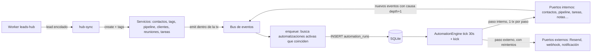

# Diseño · Automatizaciones internas

## Vista general



Hexagonal dentro del módulo: el **dominio** (catálogo, coincidencia, condiciones, plantillas,
validación) es puro y vive en `src/shared/automations.ts`; la **aplicación** (motor, enqueue,
servicio CRUD) en `src/main/automations/`; los **adaptadores** son las acciones, que llaman a los
servicios existentes a través de puertos.

## Dominio (`src/shared/automations.ts`, puro)

```ts
export type TriggerType =
  | 'contact.created'
  | 'contact.tag_added'
  | 'contact.tag_removed'
  | 'contact.subscribed'
  | 'contact.unsubscribed'
  | 'contact.bounced'
  | 'prospect.created'
  | 'prospect.stage_changed'
  | 'prospect.won'
  | 'prospect.lost'
  | 'client.created'
  | 'meeting.ready'
  | 'task.completed'
  | 'manual'
export interface Trigger {
  type: TriggerType
  params: Record<string, string>
}

export type ConditionType =
  | 'has_tag'
  | 'lacks_tag'
  | 'status_is'
  | 'source_is'
  | 'has_email'
  | 'field_equals'
  | 'field_contains'
  | 'has_client'
  | 'in_stage'
  | 'value_at_least'
  | 'stage_open'
export interface Condition {
  type: ConditionType
  params: Record<string, string>
}

export type ActionType =
  | 'add_tag'
  | 'remove_tag'
  | 'update_contact'
  | 'set_field'
  | 'append_contact_note'
  | 'assign_client'
  | 'assign_project'
  | 'unassign_client'
  | 'unsubscribe'
  | 'delete_contact'
  | 'create_prospect'
  | 'move_prospect'
  | 'update_prospect'
  | 'delete_prospect'
  | 'create_client'
  | 'create_project'
  | 'send_email'
  | 'start_sequence'
  | 'email_owner'
  | 'create_task'
  | 'create_note'
  | 'notify_mac'
  | 'webhook'
export type Step =
  | { id: string; kind: 'action'; type: ActionType; params: Record<string, string> }
  | { id: string; kind: 'wait'; amount: number; unit: 'minutes' | 'hours' | 'days' }
  | { id: string; kind: 'if'; conditions: Condition[] }

export interface Automation {
  id: string
  name: string
  active: boolean
  trigger: Trigger
  conditions: Condition[]
  steps: Step[]
  reentry: 'once' | 'always'
  destructive: boolean
  createdAt: string
  updatedAt: string
}

/** Lo que el motor sabe del sujeto al evaluar (se carga fresco antes de cada paso). */
export interface Subject {
  contact: ContactSnapshot | null
  prospect: ProspectSnapshot | null
  client: { id: string; name: string } | null
  meeting?: { id: string; title: string }
  task?: { id: string; title: string; tags: string[] }
}
```

Catálogo con metadatos para UI, validación y MCP (una sola fuente):

```ts
interface ParamSpec {
  key: string
  label: string
  kind:
    | 'text'
    | 'markdown'
    | 'number'
    | 'tag'
    | 'pipeline'
    | 'stage'
    | 'client'
    | 'project'
    | 'source'
    | 'status'
    | 'url'
    | 'field'
    | 'effort'
    | 'select'
  required?: boolean
  options?: string[]
  vars?: boolean
}
interface ActionSpec {
  type: ActionType
  group: 'contacto' | 'pipeline' | 'clientes' | 'email' | 'productividad' | 'integraciones'
  label: string
  needs: 'contact' | 'prospect' | 'client' | null
  external: boolean
  destructive: boolean
  params: ParamSpec[]
  sentence(p): string
}
export const TRIGGERS: TriggerSpec[]
export const CONDITIONS: ConditionSpec[]
export const ACTIONS: ActionSpec[]
```

Funciones puras (con tests):

- `matchesTrigger(trigger, envelope): boolean` (tag igual, pipeline/etapa iguales, fuente…).
- `evaluate(conditions, subject): boolean`.
- `render(template, subject): string` (variables de R5; HTML-escape en emails).
- `validateAutomation(input): Automation | { errors: { path: string; message: string }[] }`:
  parámetros requeridos, tipos, acciones compatibles con el sujeto del disparador
  (`task.completed` solo admite acciones con `needs: null`), `destructive` calculado y exigido.
- `describe(automation): string[]` (frases para la lista: «Cuando entra el tag webinar → esperar 1
  día → enviar «Bienvenida» → añadir tag nurture»).
- `subjectOf(envelope)`: qué ids carga el motor (contacto, prospecto, cliente…).

## Datos

Migración `AddAutomations1728700000000`:

```sql
CREATE TABLE automations (id TEXT PRIMARY KEY, name TEXT NOT NULL, active BOOLEAN NOT NULL DEFAULT 0,
  trigger TEXT NOT NULL, conditions TEXT NOT NULL DEFAULT '[]', steps TEXT NOT NULL DEFAULT '[]',
  reentry TEXT NOT NULL DEFAULT 'once', destructive BOOLEAN NOT NULL DEFAULT 0,
  created_at TEXT NOT NULL, updated_at TEXT NOT NULL);

CREATE TABLE automation_runs (id TEXT PRIMARY KEY, automation_id TEXT NOT NULL,
  status TEXT NOT NULL,            -- pending | waiting | running | done | failed | cancelled
  subject TEXT NOT NULL,           -- { contactId, prospectId, clientId, meetingId, taskId }
  event TEXT NOT NULL,             -- envelope del disparo
  steps TEXT NOT NULL,             -- copia de los pasos al disparar
  step_index INTEGER NOT NULL DEFAULT 0, next_at TEXT NOT NULL, attempts INTEGER NOT NULL DEFAULT 0,
  depth INTEGER NOT NULL DEFAULT 0, cause_run_id TEXT NULL, log TEXT NOT NULL DEFAULT '[]',
  dedupe_key TEXT NOT NULL UNIQUE, late BOOLEAN NOT NULL DEFAULT 0,
  created_at TEXT NOT NULL, updated_at TEXT NOT NULL, finished_at TEXT NULL);
CREATE INDEX idx_runs_due ON automation_runs (status, next_at);
CREATE INDEX idx_runs_automation ON automation_runs (automation_id, created_at);
CREATE INDEX idx_runs_contact ON automation_runs (json_extract(subject, '$.contactId'));
-- migrar reglas: cada fila de rules → automations (trigger tag_added, pasos equivalentes)
DROP TABLE rules;
```

`log`: `{ stepId, at, outcome: 'ok' | 'skipped' | 'error' | 'retry', message }[]` (máx 100).

## Aplicación (`src/main/automations/`)

- `enqueue.ts` · registrado con `onEvent`. Para cada automatización activa con
  `matchesTrigger`: carga el sujeto, `evaluate(conditions)`, aplica reentrada (`once` = no existe run
  `done|waiting|pending|running` de esa automatización para ese contacto), corta si
  `cause.depth >= 5` o `cause.automationId === automation.id`, e inserta la run con
  `dedupe_key = automationId:eventId`. `afterCommit` → `engine.kick()`.
- `engine.ts` · `AutomationEngine { start(); stop(); kick(); tick() }` como `MarketingSync`:
  `TICK_MS = 30_000`, nunca dos ticks a la vez. Al arrancar, `running → pending` (recuperación) y
  marca `late` las vencidas hace > 5 min. `tick`: hasta 20 runs con `next_at <= now`, por
  `next_at`. Para cada run, bucle de pasos:
  - `wait` → `next_at = now + duración`, `status = waiting`, sale.
  - `if` → `evaluate` con sujeto recargado; falso → `done` (log «no cumple»).
  - acción interna → `transactionGuard` + `withCause({ runId, automationId, depth: run.depth + 1 })`
    → `ACTION_HANDLERS[type].run(ctx)`; error → `failed`.
  - acción externa → fuera de transacción; error → `attempts++`, `next_at` con backoff
    `[1, 5, 30]` min, `status = waiting`; al 4.º fallo `failed`. Email con idempotency key
    `runId:stepId`.
  - omitida (`ctx.skip(reason)`) → log `skipped` y sigue.
- `service.ts` · `AutomationService`: `list` (con `describe`, conteos de runs por estado),
  `get`, `save` (valida, `destructive` exige `acknowledgeDestructive`), `setActive`, `remove` (cancela
  sus runs en espera), `runs(filter)`, `cancelRun`, `cancelWaiting(automationId)`,
  `test(automationId | input, contactId)` (simulación: evalúa condiciones y describe cada paso con
  `render`, sin escribir), `runManual(automationId, contactId)` (emite un envelope `manual`),
  `references(slug)` (lo usa Tags).

## Adaptadores (acciones) y puertos

`src/main/automations/actions/{contact,pipeline,clients,email,productivity,integrations}.ts`, cada uno
exporta handlers `{ [type]: { run(ctx: ActionContext): Promise<void> } }`.

```ts
interface ActionContext {
  manager?: EntityManager
  subject: Subject
  params: Record<string, string>
  render(t: string): string
  skip(reason: string): never
  ports: Ports
  runId: string
  stepId: string
}
interface Ports {
  email: EmailPort
  notifier: NotifierPort
  http: HttpPort
  settings: () => Settings
}
```

Los handlers internos reutilizan los ayudantes existentes que reciben `manager`: `changeTags`,
`setStatus`, `promoteContact`/`convert`, `insertProspect`, `insertClient`, `ProspectService.move`
(extraído a ayudante `moveProspect(manager, …)`), `TaskService` (ayudante `insertTaskWithRoom`),
`NoteService` (ayudante `insertNote` + relación con cliente), `removeProspect`, borrar contacto.

- `EmailPort.send({ to, subject, html, idempotencyKey })` → `gateway.sendEmail` (from/replyTo de
  Ajustes). Markdown → HTML con `marked` (dependencia nueva, pequeña) + `withUnsubscribeFooter`.
  `send_email` omite si `status !== 'subscribed'`.
- `NotifierPort.notify(title, body)` → `Notification` de Electron.
- `HttpPort.post(url, json)` → `fetch` con timeout 10 s; solo `https://`.

## Worker y hub

- `src/shared/automation.ts` (`runRules`) y `RuleModel`, `rule.service`, `Rules.tsx`, rutas e IPC de
  reglas se eliminan.
- `HubConfig`: sin `rules`; gana `audience` (módulo tags). `HubLeadItem.added` = tags que entraron;
  `removed/events/promote` quedan opcionales y vacíos en el Worker nuevo.
- `hub-sync.applyLead`: contacto nuevo → `emit('contact.created')`; `changeTags(… rules: false)` emite
  `contact.tag_added` por cada tag → las automatizaciones corren en la app.
- Ítems del Worker viejo: si traen `events/promote`, se aplican como hoy (transición).

## UI

```
screens/Automations.tsx            lista (tarjetas con frases de describe, toggle, conteos, badge errores)
screens/Automation.tsx             editor + pestaña Ejecuciones
organisms/TriggerCard              tipo + parámetros
organisms/ConditionList            filtros (añadir, quitar)
organisms/StepList                 pasos verticales con «+» entre pasos, arrastrar para reordenar
molecules/StepCard                 icono del grupo + frase; clic expande el editor de parámetros
organisms/StepPicker               Modal: grupos + buscador
molecules/ParamField               un campo por ParamSpec (tag, pipeline, etapa, markdown con variables…)
molecules/VariableChips            insertar {{variables}} en el campo enfocado
organisms/RunsTable                ejecuciones: estado, sujeto, fecha, paso actual; expandir = log
organisms/TestDrawer               Drawer: elegir contacto → resultado de la simulación paso a paso
```

Barra lateral: el grupo «Email» pasa a «Automatización» con Fuentes, Automatizaciones, Secuencias y
Newsletters. Ficha de contacto: sección «Automatizaciones» (runs del contacto) y «Ejecutar
automatización» en «Más».

Brief impeccable (Operate):

- Leer antes que construir: una automatización se entiende como una frase en la lista y como una
  columna vertical en el editor (Disparador → Filtros → Pasos → Fin), de arriba abajo, como se ejecuta.
- Sin lienzo ni flechas: los pasos son tarjetas apiladas con un hilo vertical hairline entre ellas y
  un «+» circular quiet en cada hueco. La espera se dibuja distinta (pill pequeña con reloj sobre el
  hilo), porque es tiempo, no acción.
- Un paso cerrado es una frase; abierto, sus campos en el sitio (inset apricot al 40% como hoy en
  Reglas). Un solo paso abierto a la vez.
- Color con significado: acciones destructivas en rose; errores de ejecución en coral; activo/pausado
  como hoy (pausada al 60%). Grupos solo con icono, sin color propio.
- Guardar explícito (apricot) con «Cambios sin guardar»; validación junto al campo.
- Estados: lista vacía con 3 ejemplos de un clic (bienvenida a lead nuevo, tarea al ganar, aviso al
  rebotar); ejecuciones vacías; Resend no configurado (aviso apricot en pasos de email).

## MCP

`list_automation_catalog` devuelve `TRIGGERS`, `CONDITIONS`, `ACTIONS` con `ParamSpec` (para que
Claude construya JSON válido) · `list_automations` · `get_automation` · `save_automation { id?, name,
trigger, conditions?, steps, reentry?, acknowledge_destructive? }` · `set_automation_status` ·
`delete_automation { id, confirm }` · `test_automation { id | definition, contact }` ·
`run_automation { id, contact }` · `list_automation_runs { automation?, contact?, status? }` ·
`cancel_automation_run { id }`.
